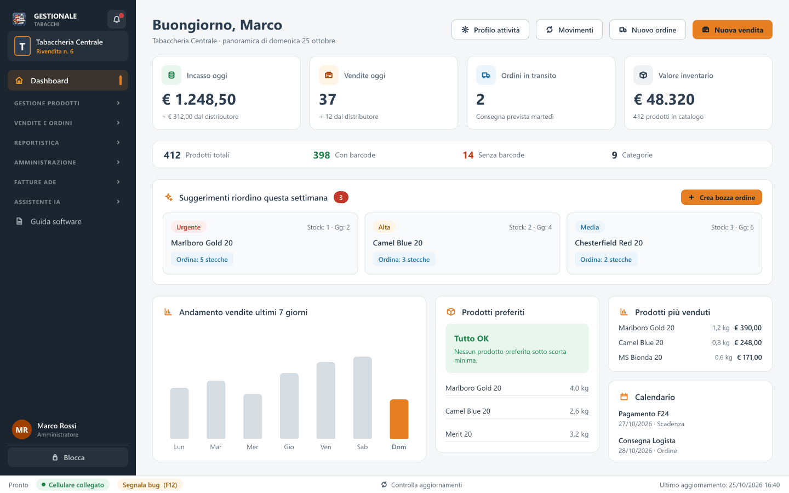
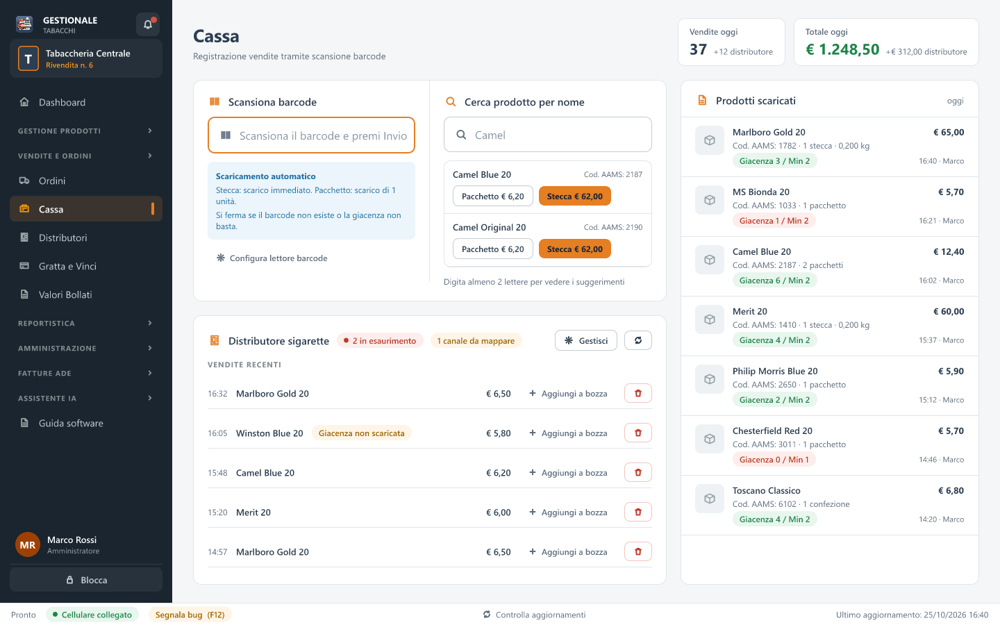
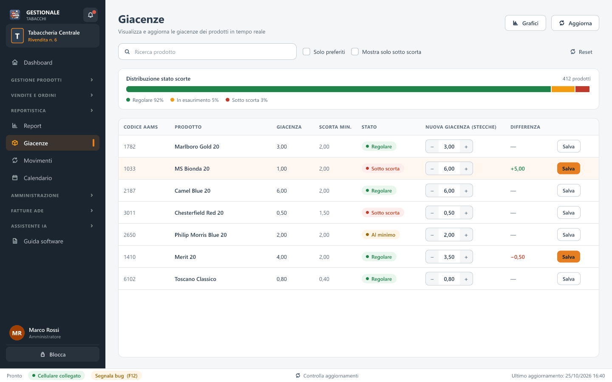
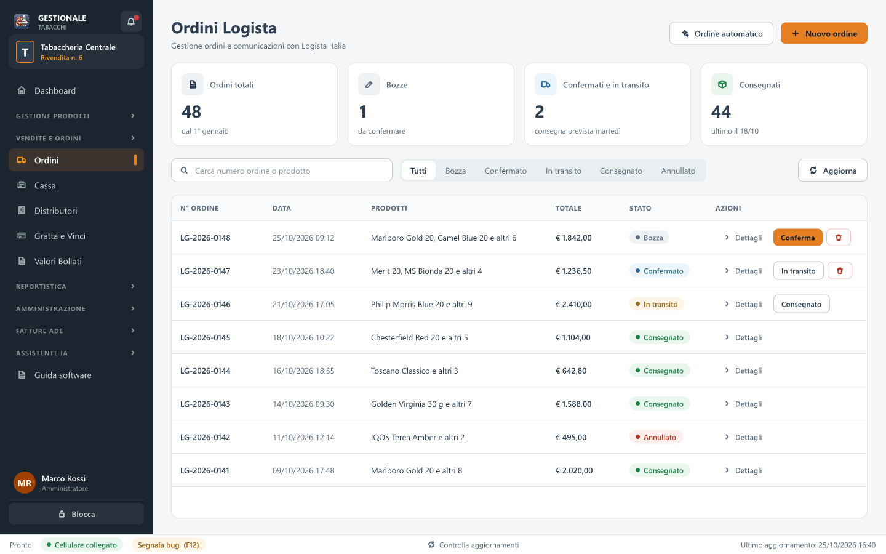
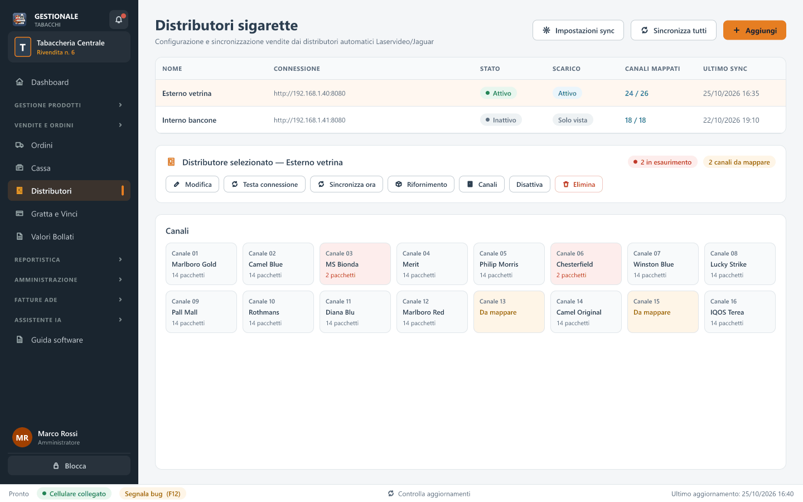
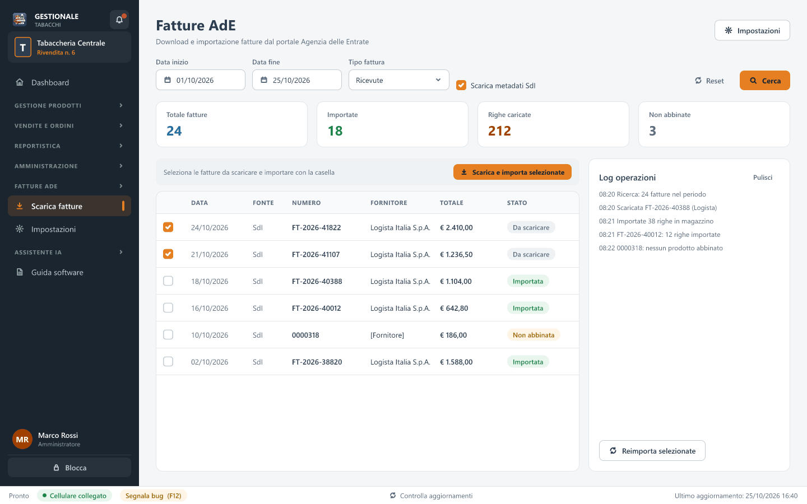
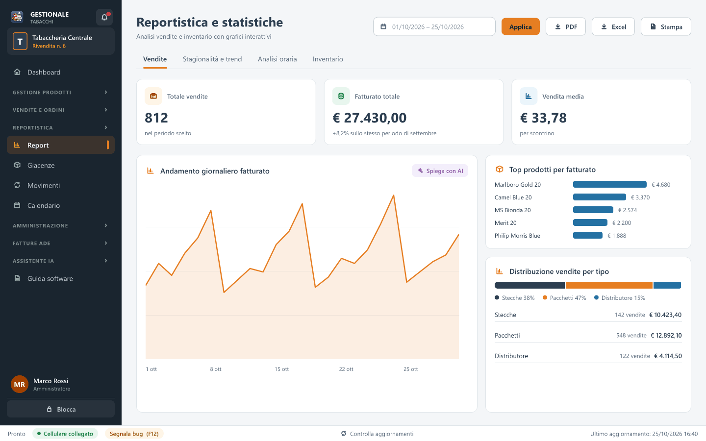

# Gestionale Tabacchi

Applicativo desktop per la gestione di tabaccherie, conforme alle normative ADM/Logista: vendite in cassa con lettore barcode, giacenze, ordini al grossista, distributori automatici, fatture elettroniche e un assistente basato su intelligenza artificiale.

## Download

**Versione corrente: 1.2.0.9** — aggiornato il 31/10/2026

[Scarica GestionaleTabacchi_Setup_1.2.0.9.exe](https://github.com/Gioixxx/Gestionale-Tabaccherie/releases/download/v1.2.0.9/GestionaleTabacchi_Setup_1.2.0.9.exe)

## Installazione

1. Scarica il file `GestionaleTabacchi_Setup_1.2.0.9.exe`.
2. Eseguilo come **Amministratore**.
3. Segui la procedura guidata: l'applicativo viene scaricato e installato automaticamente.
4. Al termine avvia **Gestionale Tabacchi** dal menu Start o dal Desktop.

> L'installer è un piccolo programma (circa 5 MB): scarica l'ultima versione dell'applicativo durante la procedura, quindi serve una connessione internet.

## Cosa puoi fare

| | |
|---|---|
| **Cassa** | Vendita di stecche e pacchetti con la scansione del barcode, scarico automatico della giacenza e storno delle vendite. |
| **Giacenze e movimenti** | Giacenza di ogni prodotto, scorta minima, rettifiche di inventario e storico dei movimenti di magazzino. |
| **Ordini Logista** | Bozze d'ordine, suggerimenti di riordino, esportazione in PDF e consegna con carico automatico a magazzino. |
| **Listino e barcode** | Importazione del listino da Logista o da Excel, assegnazione dei barcode, stampa delle etichette. |
| **Distributori** | Sincronizzazione delle vendite del distributore di sigarette e controllo dei canali in esaurimento. |
| **Gratta e Vinci e valori bollati** | Carico, attivazione e vendita dei biglietti; gestione dei valori bollati. |
| **Fatture AdE** | Ricerca sul portale Fatture e Corrispettivi e importazione delle fatture come carichi di magazzino. |
| **Report e calendario** | Report di vendita e di inventario, scadenze ed eventi ricorrenti. |
| **Assistente IA** | Una chat a cui chiedere in italiano incassi, prodotti sotto scorta o come si usa il programma. |
| **Estensione mobile** | Lo smartphone, sulla stessa rete Wi-Fi, per fotografare fatture e prodotti e controllare le giacenze. |
| **Sicurezza dei dati** | Più utenti con permessi diversi, backup manuali e automatici, ripristino da copia. |

## Schermate

<table>
  <tr>
    <td width="50%"> <b>Cassa</b> — scansione del barcode, prodotti scaricati e vendite del distributore.</td>
    <td width="50%"> <b>Giacenze</b> — scorte per prodotto e rettifiche di inventario.</td>
  </tr>
  <tr>
    <td width="50%"> <b>Ordini Logista</b> — bozze, ordini in transito e consegne.</td>
    <td width="50%"> <b>Distributori</b> — vendite sincronizzate e stato dei canali.</td>
  </tr>
  <tr>
    <td width="50%"> <b>Fatture AdE</b> — ricerca sul portale e importazione a magazzino.</td>
    <td width="50%"> <b>Report</b> — vendite e inventario per periodo.</td>
  </tr>
</table>

*Le schermate sono illustrative: i nomi e i valori che vi compaiono sono d'esempio.*

## Requisiti di sistema

- Windows 10 / Windows 11 (64 bit)
- Connessione internet, per il download iniziale, gli aggiornamenti, il listino Logista e le fatture
- Microsoft Visual C++ Redistributable x64 (installato automaticamente se manca)

## Aggiornamenti

L'applicativo controlla gli aggiornamenti all'avvio e si aggiorna da solo. Dalle impostazioni puoi scegliere il canale: **Stabile** per le versioni pronte all'uso, **Beta** per provare in anticipo le novità.

## Guida

Il programma ha una guida integrata: in ogni pagina il pulsante **Guida**, accanto al titolo, apre il capitolo relativo, e lo stesso fa il tasto **F1**.

## Supporto

Per assistenza tecnica contattare il fornitore dell'applicativo.
